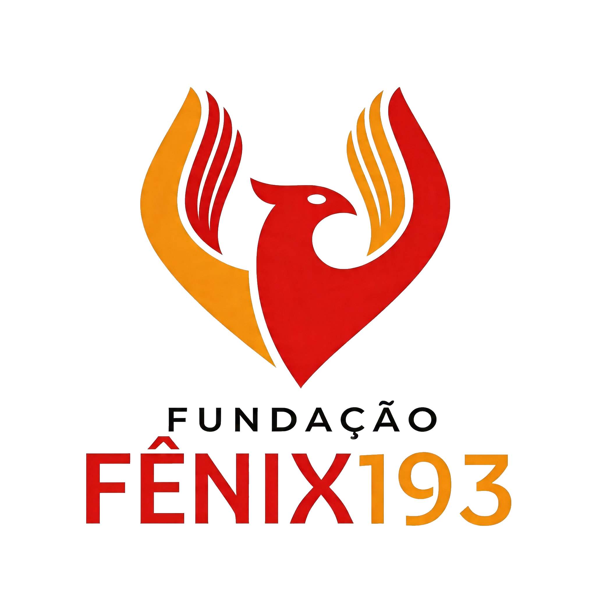

<div align="center">



# Fundação Fênix 193 — Ecossistema Digital

**`v1.3.0`** · Junho 2026 · Produção estável

[](https://ff193.vercel.app)
[](https://firebase.google.com)
[](https://developer.mozilla.org/en-US/docs/Web/JavaScript)
[](#créditos)

*Sistema web completo para fundação de apoio ao CBMSE — site institucional, painel administrativo, portal de transparência, notícias, eventos e chatbot institucional.*

</div>

---

## Índice

- [Visão Geral](#-visão-geral)
- [Arquitetura e Stack](#-arquitetura-e-stack)
- [Produtos do Ecossistema](#-produtos-do-ecossistema)
- [Site Público](#-site-público)
- [AkanniHub — Painel Administrativo](#-akannihub--painel-administrativo)
- [Acessibilidade Audiovisual](#-acessibilidade-audiovisual)
- [Chatbot LuminIA](#-chatbot-luminia)
- [Segurança — Firestore Rules](#-segurança--firestore-rules)
- [Estrutura de Arquivos](#-estrutura-de-arquivos)
- [Configuração e Deploy](#-configuração-e-deploy)
- [Versionamento](#-versionamento)
- [Correções Recentes](#-correções-recentes)
- [Roadmap — Próximas Atualizações](#-roadmap--próximas-atualizações)
- [Créditos](#-créditos)

---

## 📌 Visão Geral

Sistema web institucional desenvolvido por **GeoCODE Programmer (Geovani Santos)** para a **Fundação Fênix 193** — entidade privada sem fins lucrativos com sede em Aracaju/SE, criada para apoiar o Corpo de Bombeiros Militar de Sergipe (CBMSE) e as ações de Proteção e Defesa Civil.

O projeto é composto por dois produtos integrados via Firebase, ambos em stack vanilla sem build tools, com deploy contínuo na Vercel.

> **Filosofia de desenvolvimento:** zero dependências de framework, zero processo de build, CSS modular com design tokens, Firebase SDK v9 via CDN ESM — máxima performance e manutenção acessível ao time técnico.

---

## 🛠 Arquitetura e Stack

### Frontend

| Camada | Tecnologia |
|--------|-----------|
| Marcação | HTML5 semântico (ARIA, roles, landmarks) |
| Estilização | CSS3 + Custom Properties (design tokens) |
| Lógica | JavaScript ES6+ Vanilla, ES Modules |
| Fontes | Google Fonts — Barlow Condensed · Barlow |
| Ícones | Font Awesome 6.5 |

### Backend / BaaS

| Serviço | Finalidade |
|---------|-----------|
| Firebase Authentication | Login Google OAuth 2.0 (admins) |
| Cloud Firestore | Banco NoSQL — 5 coleções |
| Firebase Security Rules | Controle de acesso granular por coleção (v1.2.0) |
| Firebase Analytics | Métricas de acesso (opt-in LGPD) |
| Cloudinary | Upload e hospedagem de imagens das notícias |

### Infraestrutura

| Item | Configuração |
|------|-------------|
| Hosting | Vercel |
| Roteamento | `cleanUrls: true`, `trailingSlash: false`, 404 customizado |
| Cache assets | `max-age=31536000, immutable` |
| Cache HTML | `max-age=0, must-revalidate` |
| Headers de segurança | `X-Content-Type-Options`, `X-Frame-Options: SAMEORIGIN`, `Referrer-Policy` |
| Domínio | `ff193.vercel.app` |

---

## 🗂 Produtos do Ecossistema

| # | Produto | Rota | Público-alvo |
|---|---------|------|-------------|
| 1 | **Site Institucional Público** | `/` e `/pages/*` | Sociedade, parceiros, imprensa |
| 2 | **AkanniHub (Painel Admin)** | `/akannihub` | Administradores autorizados |

---

## 🌐 Site Público

### Hero & Busca Global

- Campo de busca com **dropdown inteligente** de resultados em tempo real.
- Índice **estático** (15 páginas/seções) combinado com índice **dinâmico** (notícias e documentos carregados do Firestore).
- Highlight das palavras-chave nos resultados.
- Navegação por teclado (`ArrowUp`, `ArrowDown`, `Enter`, `Escape`).
- Feed de **últimas 3 notícias** em grid 3×1 diretamente no hero.

### Navegação

- Header fixo com **menu hamburger** responsivo para mobile.
- **Dropdowns** com suporte a hover (desktop) e clique (mobile).
- Fechamento automático ao clicar fora ou pressionar `Esc`.
- 2 grupos de dropdown: Institucional e Atuação.

### Seções da Home

| Seção | Descrição |
|-------|---------|
| **Quem Somos** | Carrossel automático de 4 imagens com autoplay, dots e botões prev/next |
| **Números que Impactam** | Contadores animados ativados por IntersectionObserver |
| **Áreas de Atuação** | Grid de 4 cards (Apoio Operacional, Capacitação, Projetos Sociais, Prevenção) |
| **Projetos em Destaque** | 3 cards visíveis + toggle "ver todos" com animação escalonada |
| **Como Ajudar** | 3 cards: Doações (PIX), Parcerias (empresas), Voluntariado |
| **Últimas Notícias** | 2 cards carregados dinamicamente do Firestore com skeleton loading |
| **Instituidores & Apoiadores** | Carrossel marquee animado (ativa somente com ≥ 5 cards) |
| **Formulário de Contato** | Envio para coleção `contacts` no Firestore — suporte a denúncias anônimas |
| **Banner de Cookies (LGPD)** | Opt-in para Firebase Analytics com persistência em `localStorage` |

### Subpáginas Institucionais

<details>
<summary><strong>🏛 Nossa História</strong></summary>

- Linha do tempo vertical com cards alternados (esquerda/direita).
- Grid de 4 pilares fundadores.
- CTA para "Como Ajudar" e página de Equipe.

</details>

<details>
<summary><strong>🎯 Missão e Valores</strong></summary>

- 3 cards MVV com gradientes distintos (Missão, Visão, Valores).
- Grid de 5 valores detalhados com ícones e descrições.
- CTA para Projetos e Transparência.

</details>

<details>
<summary><strong>👥 Equipe</strong></summary>

- Organograma com 4 conselhos: Presidente de Honra, Curadores, Executivo e Fiscal.
- Cards com fotos reais, nome e cargo de cada membro.
- Hover com barra de destaque animada.

</details>

<details>
<summary><strong>📂 Transparência</strong></summary>

- Portal dinâmico com documentos agrupados por 7 categorias (Prestação de Contas, Relatórios, Estatuto, Certidões, Contratos, Editais, Atas).
- Documentos carregados do Firestore em tempo real.
- Cada documento abre diretamente no Google Drive (nova aba).
- Estado de loading, vazio e erro tratados com feedback visual.

</details>

<details>
<summary><strong>📋 Projetos</strong></summary>

- Grid com filtros por status: Todos / Em Planejamento / Em Andamento / Finalizados / Cursos.
- Contador de projetos visíveis atualizado dinamicamente.
- Modal de detalhe com ícone, status badge, descrição, área, público-alvo e objetivo.
- CTA para contato e parceria.

</details>

<details>
<summary><strong>🎓 Capacitação</strong></summary>

- Strip de 5 diferenciais (instrutores, certificação, turmas, in company, conteúdo).
- Catálogo de cursos com conteúdo programático, carga horária e badges de categoria.
- Processo de inscrição em 5 etapas.
- CTA in company para proposta personalizada.

</details>

<details>
<summary><strong>📅 Eventos</strong></summary>

- Feed dinâmico do Firestore com separação automática entre **Próximos** e **Realizados** (tabs).
- Bloco de data visual por evento (vermelho = futuro, navy = passado).
- Badge de custo (Gratuito / Pago) e botão de inscrição por link externo.
- Estado de vazio customizado por categoria (próximos vs. histórico).

</details>

<details>
<summary><strong>🤝 Parcerias</strong></summary>

- Grid "Por que ser Parceiro?" com cards de benefícios.
- Processo em 5 etapas (Interesse → Reunião → Proposta → Termo → Ativo).
- Grid de logos de instituidores e apoiadores com hover colorido.
- CTA para contato e transparência.

</details>

<details>
<summary><strong>📰 Notícias</strong></summary>

- Grid paginado (9 por página) com `startAfter` do Firestore.
- Primeiro card em destaque (`featured`, layout horizontal).
- Modal de leitura completa com imagem hero, meta, corpo e compartilhamento.
- Compartilhamento via **WhatsApp** e **Clipboard** com feedback visual.
- URL com `?noticia=ID` para links diretos por notícia.
- Skeletons de loading e estados de vazio e erro.

</details>

### Widget "Segurança & Defesa Civil"

- Bloco lateral que exibe automaticamente as últimas notícias publicadas nos sites oficiais do **CBMSE** e da **Defesa Civil de Sergipe**, com abas para alternar entre as duas fontes.
- Busca as notícias em tempo real diretamente dos feeds públicos desses órgãos — a Fundação não precisa cadastrar nada manualmente.
- Caso os serviços externos estejam temporariamente indisponíveis, o widget exibe a última versão salva no navegador do visitante, evitando bloco vazio.

### 404 Personalizada

- Animação CSS de gradiente de fogo no número "404".
- Ícone de chama animado com `float`.
- Botão de retorno à home.

---

## 🔧 AkanniHub — Painel Administrativo

SPA (Single Page Application) de gestão de conteúdo acessível em `/akannihub`, protegida por autenticação Google OAuth com verificação de permissão contra a coleção `admins` no Firestore.

### Autenticação & Controle de Acesso

- Login exclusivo via **Google Sign-In** (popup).
- Verificação de UID contra documento `admins/{uid}` no Firestore após autenticação.
- Contas não autorizadas são imediatamente desconectadas com mensagem explicativa.
- Avatar e nome do usuário exibidos na topbar após login.

### Dashboard

- 3 cards de estatísticas em tempo real: total de mensagens, documentos e notícias.
- Badge de contagem de mensagens não lidas no item do menu lateral.
- Acesso rápido para as 3 principais ações (ver mensagens, novo doc, nova notícia).

### Módulos disponíveis

<details>
<summary><strong>📬 Contatos</strong></summary>

- Tabela completa com todas as mensagens recebidas pelo formulário público.
- Colunas: Nome, E-mail, Assunto (badge colorido), Mensagem (truncada), Data.
- **Ações por linha:** Modal de detalhe, abrir WhatsApp com mensagem pré-preenchida, abrir cliente de e-mail, excluir com confirmação.
- Botão de atualização manual.
- Cache local das mensagens para abertura rápida do modal.

</details>

<details>
<summary><strong>📁 Transparência</strong></summary>

- Formulário: Nome do arquivo, Link (Google Drive), Categoria.
- 7 categorias: Prestação de Contas, Relatórios Institucionais, Estatuto Social, Certidões, Contratos, Editais, Atas.
- Lista com ícone por categoria, data de publicação, link externo e exclusão confirmada.

</details>

<details>
<summary><strong>✍️ Notícias</strong></summary>

- Formulário: Título, Autor, Texto (textarea), Imagem de Capa.
- Upload de imagem para **Cloudinary** com barra de progresso e preview em tempo real.
- Suporte a drag-and-drop na zona de upload.
- Modo de edição inline com preenchimento automático do formulário.
- Lista com thumbnail, título, autor, data e ações (editar / excluir).

</details>

<details>
<summary><strong>📅 Eventos</strong></summary>

- Formulário: Título, Data, Horário, Local, Custo (Gratuito/Pago), Link de Inscrição (opcional), Descrição.
- Lista com bloco de data visual (vermelho = futuro, navy = passado), badge de status e ações.
- Edição inline e exclusão com confirmação.
- Helper `parseDateLocal()` para parsing correto sem deslocamento de fuso horário.

</details>

<details>
<summary><strong>🛠 Suporte Técnico</strong></summary>

- Link direto para abertura de chamado via template YAML no GitHub Issues.
- Credenciais de acesso ao GitHub de suporte exibidas no painel.

</details>

### UX do Painel

| Feature | Detalhe |
|---------|---------|
| **Navegação SPA** | Alternância de seções via classes CSS sem recarregamento de página |
| **Modal de confirmação** | Componente global reutilizável para todas as exclusões |
| **Toast notifications** | Sistema success/error/default com auto-dismiss em 4 segundos |
| **Responsividade** | Sidebar colapsável em mobile via botão hamburger |
| **Sidebar badge** | Contagem de mensagens não lidas atualizada ao carregar |

---

## ♿ Acessibilidade Audiovisual

Componente próprio, independente do restante do site, adicionado a todas as páginas.
Conformidade: **WCAG 2.1 nível AA** e **eMAG**.

| Arquivo | Local no projeto | Função |
|---------|------------------|--------|
| `acessibilidade.css` | `css/acessibilidade.css` | Botão flutuante, popover de contraste/fonte, foco visível |
| `acessibilidade.js` | `js/acessibilidade.js` | Lógica do painel (auto-injetado via JS) |
| `media-player.js` | `js/media-player.js` | Player de vídeo customizado com audiodescrição |
| `*.json` de faixa AD | `assets/data/` | Faixas de audiodescrição (tempo + texto) por vídeo |

**Painel de ferramentas (botão flutuante inferior direito):**
- Tamanho de fonte (A−/A/A+) em `rem`, com persistência em `localStorage`
- 3 temas de contraste — Padrão, Alto Contraste Escuro, Alto Contraste Amarelo/Preto
- Design minimalista: popover compacto em vez de sidebar de tela cheia
- Foco preso ao painel (focus trap), fecha com `Esc`, `skip link` para o conteúdo principal

**Player de mídia com audiodescrição:**
- Controles customizados 100% acessíveis via teclado (Espaço, Setas)
- Botão dedicado de Audiodescrição (AD)
- Narração via `window.speechSynthesis`, sincronizada aos tempos do vídeo, pausando a reprodução durante a fala
- Texto da descrição também exposto em um container `aria-live="polite"`, garantindo acesso mesmo sem suporte à Speech API

---

## 🤖 Chatbot LuminIA

Assistente virtual flutuante presente na home e nas subpáginas.

| Feature | Detalhe |
|---------|---------|
| **Interface** | Botões de opção (sem input de texto livre) |
| **Categorias** | Sobre a Fundação · Projetos e Atuação · Como Colaborar · Transparência · Contato |
| **Subcategorias** | Quem Somos, Missão, Equipe, Projetos, Capacitação, Eventos, Parcerias, Doação, Voluntariado, WhatsApp, Redes Sociais |
| **Indicador de digitação** | Animação de 3 dots entre interações |
| **Rotas relativas** | Ajuste dinâmico de caminhos conforme a subpágina atual |
| **Encerramento** | Botão "Encerrar" fecha o chat automaticamente após 2 segundos |

---

## 🔒 Segurança — Firestore Rules

**Versão das regras:** `v1.2.0` · Maio 2026

| Coleção | Leitura | Escrita | Validações |
|---------|---------|---------|-----------|
| `admins/{uid}` | Próprio UID autenticado | Bloqueada (apenas Console) | — |
| `contacts/{id}` | Apenas admins | Pública (formulário) | email regex · mensagem ≤ 4.000 chars · campo `read: bool` |
| `transparency_docs/{id}` | Pública | Apenas admins | nome ≤ 200 · link ≤ 500 · categoria enum (7 valores) |
| `news/{id}` | Pública | Apenas admins | título ≤ 300 · autor ≤ 100 · corpo ≤ 50.000 chars |
| `eventos/{id}` | Pública | Apenas admins | data YYYY-MM-DD · horário HH:MM · custo enum · descrição ≤ 10.000 chars |

**Funções auxiliares:**

| Função | Descrição |
|--------|-----------|
| `isSignedIn()` | Verifica autenticação ativa |
| `isAdmin()` | Verifica `admins/{uid}` sem varredura da coleção inteira |
| `requiredString(field)` | Valida string não-vazia |
| `isValidContact()` | Validador completo para formulário público |
| `isValidTransparencyDoc()` | Validador com enum de categorias |
| `isValidNews()` | Validador de campos e limites de tamanho |
| `isValidEvento()` | Validador com enum de custo e formato de data/hora |

---

## 📁 Estrutura de Arquivos

```
ff193/
├── index.html                         # Página inicial (home)
├── 404.html                           # Página de erro personalizada
├── akannihub.html                     # Painel administrativo (autenticado)
├── firestore.rules                    # Regras de segurança Firestore v1.2.0
├── vercel.json                        # Configuração de deploy, cache e headers
├── site.webmanifest                   # PWA manifest
├── sitemap.xml                        # Mapa do site para SEO
├── robots.txt                         # Diretivas para crawlers
│
├── pages/                             # Subpáginas públicas
│   ├── nossa-historia.html
│   ├── missao-valores.html
│   ├── equipe.html
│   ├── projetos.html
│   ├── capacitacao.html
│   ├── eventos.html
│   ├── parcerias.html
│   ├── noticias.html
│   └── transparencia.html
│
├── assets/
│   ├── css/
│   │   ├── style.css                  # Design system global (tokens, layout, componentes)
│   │   ├── dropdown.css               # Menu dropdown desktop/mobile
│   │   ├── pages.css                  # Estilos compartilhados entre subpáginas
│   │   ├── noticias.css               # Grid, modal e estilos da página de notícias
│   │   ├── chatbot.css                # Chatbot flutuante LuminIA
│   │   └── 404.css                    # Animação da página de erro
│   │
│   ├── js/
│   │   ├── script.js                  # Lógica principal: menu, notícias, contato, LGPD
│   │   ├── search.js                  # Motor de busca hero (estático + Firestore)
│   │   └── chatbot.js                 # Assistente virtual LuminIA
│   │
│   ├── img/                           # Imagens estáticas (logos, fotos institucionais)
│   └── ui/                            # Favicons e ícones PWA
│
└── .github/
    └── ISSUE_TEMPLATE/
        └── solicitacao_cliente.yml    # Template de chamado de suporte para clientes
```

---

## ⚙️ Configuração e Deploy

### Pré-requisitos

- Projeto Firebase `fundacaofenix193` configurado (Auth + Firestore + Analytics)
- Conta Cloudinary com upload preset `ffenix193` (unsigned) e cloud name `darq3foje`
- Conta Vercel com repositório vinculado

### Variáveis de configuração

Todas as configurações estão inline nos arquivos JS (sem `.env`):

| Arquivo | Constante | Finalidade |
|---------|-----------|-----------|
| `assets/js/script.js` | `firebaseConfig` | Credenciais do projeto Firebase |
| `akannihub.html` | `CLOUDINARY_CLOUD` / `CLOUDINARY_PRESET` | Upload de imagens das notícias |

### Deploy

```bash
# Via painel Vercel (recomendado):
# 1. Conectar repositório GitHub
# 2. Framework Preset: Other
# 3. Build Command: (vazio)
# 4. Output Directory: . (raiz)
# 5. Deploy

# Publicar regras do Firestore:
npm install -g firebase-tools
firebase login
firebase deploy --only firestore:rules
```

### Adicionar um novo admin

```
Firebase Console → Firestore → coleção "admins"
Criar documento com ID = UID do usuário (Auth → Users)
Campos mínimos: { email: "admin@exemplo.com", name: "Nome" }
```

---

## 🏷 Versionamento

O projeto adota **Semantic Versioning (SemVer)**:

```
v1.3.0
│ │ └── Patch  — correções de bugs, ajustes de CSS, atualização de conteúdo
│ └──── Minor  — novas features, novos módulos, novas páginas
└────── Major  — mudança arquitetural significativa ou quebra de compatibilidade
```

### Histórico de marcos

| Versão | Marco |
|--------|-------|
| `v0.1.0` | Estrutura inicial: home, seções estáticas, Firebase config |
| `v0.5.0` | Subpáginas institucionais, dropdown nav, footer completo |
| `v0.8.0` | AkanniHub v1 (contatos, transparência, notícias), Firestore Rules v1.0 |
| `v1.0.0` | Módulo de eventos, chatbot LuminIA, busca global, hero news feed |
| `v1.1.0` | Firestore Rules v1.2.0, LGPD/cookies, headers de segurança no Vercel |
| `v1.2.0` | GitHub Issues template, carrossel de apoiadores marquee, PWA manifest |
| `v1.3.0` | README profissional, consolidação e auditoria da base de código |
| **`v1.4.0`** | **Componente de Acessibilidade Audiovisual (WCAG 2.1 AA / eMAG), correção de bug de banner (CSS crítico x assíncrono)** |

---

## 🐛 Correções Recentes

**Banner de página some ~1s após o carregamento (CSS crítico x assíncrono)**

O projeto usa CSS crítico inline (renderização instantânea) + `pages.css` carregado de forma assíncrona (`media="print"` com swap no `onload`). Duas inconsistências entre essas duas camadas causavam o efeito de a imagem de fundo "piscar e sumir":

- `noticias.html`: a seção `.page-hero` não tinha nenhuma classe de variante (`--historia`, `--equipe` etc.). A imagem definida no CSS crítico (`bomb7.webp`) era sobrescrita pela regra genérica de `pages.css` (sem imagem) assim que este terminava de carregar. **Corrigido** com a nova classe/regra `.page-hero--noticias`.
- `index.html`: o CSS crítico do hero referenciava `bomb_2.webp` (nome inconsistente com o resto do projeto, que usa `bomb2.webp`). **Corrigido** para manter o mesmo nome de arquivo em todas as referências.

---

## 🚀 Roadmap — Próximas Atualizações

As sugestões abaixo foram derivadas da análise da base de código atual e representam evoluções naturais do sistema.

---

### 🔴 Alta Prioridade

#### `v1.4.0` — Preenchimento de Conteúdo Real
Etapa natural de um projeto em desenvolvimento: a estrutura e o funcionamento das páginas já estão prontos, faltando apenas a Fundação repassar as informações finais para publicação. Itens previstos:
- Preencher a linha do tempo em `nossa-historia.html` com os marcos reais da Fundação.
- Completar os cards de `capacitacao.html` com cursos reais (carga horária, nível, módulos).
- Substituir os cards de exemplo em `projetos.html` pelos projetos reais.
- Preencher os cards "Por que ser Parceiro" em `parcerias.html`.
- Atualizar telefone, CNPJ e links de redes sociais em todo o site.
- Atualizar os contadores de impacto com os números reais da Fundação.

#### `v1.4.1` — Segurança: App Check e Credenciais
- Implementar **Firebase App Check** para bloquear requisições ao Firestore originárias de fora do domínio oficial.
- Remover as credenciais de suporte (email/senha do GitHub) da seção de Suporte Técnico no AkanniHub; substituir por link direto sem expor credenciais em tela.

---

### 🟡 Média Prioridade

#### `v1.5.0` — Módulo de Doações com PIX
- Integrar gerador de **QR Code PIX** dinâmico (payload EMV + CRC16) na home e na página "Como Ajudar".
- Modal de doação com valores sugeridos e instrução de cópia do código.

#### `v1.5.1` — Notificações por E-mail ao Receber Contato
- Implementar **Vercel Serverless Function** ou integração com **EmailJS / SendGrid** para envio automático de e-mail aos admins ao receber nova mensagem no formulário público.

#### `v1.6.0` — Módulo de Voluntários no AkanniHub
- Criar coleção `voluntarios` no Firestore.
- Formulário público de cadastro (nome, área de atuação, disponibilidade, contato).
- Seção de gestão no AkanniHub para visualizar, filtrar e excluir cadastros.
- Regras de segurança correspondentes (criação pública com validação, leitura restrita a admins).

#### `v1.6.1` — Estatísticas de Impacto Gerenciáveis
- Substituir os `data-target="0"` por valores editáveis: criar coleção `stats` no Firestore.
- Adicionar card no Dashboard do AkanniHub para atualizar os números de impacto sem tocar no código.

---

### 🟢 Melhorias e Qualidade de Vida

#### `v1.7.0` — PWA Completa com Service Worker
- Implementar `sw.js` com estratégias de cache (Network First para Firestore, Cache First para assets).
- Suporte offline para páginas visitadas anteriormente.
- Prompt de instalação ("Adicionar à tela inicial") em Android e iOS.

#### `v1.7.1` — Acessibilidade Avançada (WCAG 2.1 AA)
- Auditoria completa com Lighthouse e axe DevTools.
- Adicionar link "Pular para o conteúdo" no topo de todas as páginas.
- Revisar contraste de `var(--gray)` em fundos claros.
- Garantir `aria-live` em todas as áreas de conteúdo dinâmico.

#### `v1.8.0` — Modo Escuro
- Implementar `data-theme="dark"` via override de CSS Custom Properties.
- Toggle no header com persistência em `localStorage`.
- Os design tokens já estão centralizados em `style.css`, tornando esta evolução de baixa complexidade.

#### `v1.8.1` — Variáveis de Configuração em Ambiente Vercel
- Mover credenciais do Cloudinary para variáveis de ambiente Vercel.
- Criar um endpoint Vercel Function mínimo para servir as credenciais ao frontend sem expô-las no código-fonte.

---

### 🔵 Longo Prazo / Exploratório

#### `v2.0.0` — Editor Rico de Notícias no AkanniHub
- Substituir o `<textarea>` plano por um editor **WYSIWYG** (Quill.js ou TipTap, sem build step).
- Suporte a listas, negrito, itálico, links e imagens embutidas no corpo das notícias.

#### `v2.0.0` — Galeria de Fotos/Eventos no Site
- Módulo de galeria fotográfica gerenciado pelo AkanniHub.
- Exibição pública com lightbox e agrupamento por evento.
- Upload de múltiplas imagens para Cloudinary com progresso.

#### `v2.0.0` — Integração com Redes Sociais
- Widget de últimas publicações do Instagram na home.
- Botão de compartilhamento nativo em cada notícia e evento.
- Metadados Open Graph completos por página para preview rico em WhatsApp e redes sociais.

---

## 👨‍💻 Créditos

<div align="center">

| | |
|--|--|
| **Desenvolvimento** | Geovani Santos — GeoCODE Programmer |
| **Portfólio** | [eusougeovani.vercel.app](https://eusougeovani.vercel.app) |
| **Suporte técnico** | (79) 9 8866-3905 |
| **Cliente** | Fundação Fênix 193 — Aracaju/SE |
| **Site** | [ff193.vercel.app](https://ff193.vercel.app) |

*Desenvolvido com ☕ por GeoCODE Programmer — 2025 / 2026*

</div>
